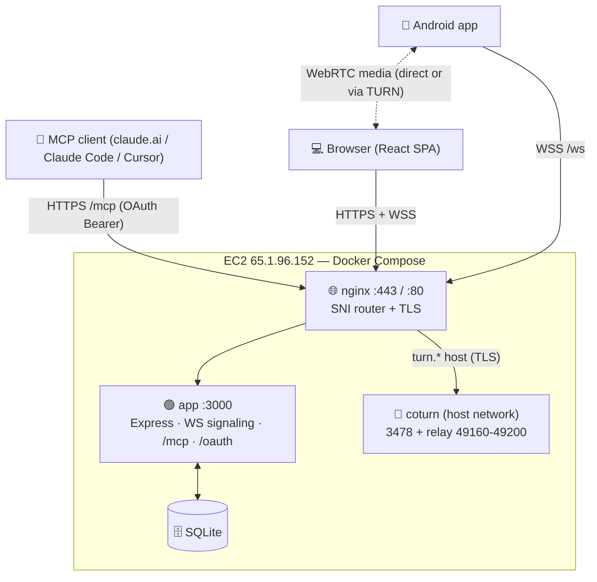

# 🧠 PROJECT MEMORY & SYSTEM MASTER ARCHITECTURE
> **Document Purpose**: Handover and operating manual for any incoming AI agent or engineer. Infra details live in [`DEPLOY.md`](DEPLOY.md); user-facing docs in [`README.md`](README.md). This file is the map plus the agent playbook (sections 10–11).

---

## 📌 1. Executive Summary & Purpose
* **Project Name**: Phone Remote — an **MCP server that gives AI agents a real Android phone**.
* **What it does**: Like Claude Computer Use for desktops, Phone Remote lets any MCP client (claude.ai, Claude Desktop/Code, Cursor, Antigravity) see and drive a physical Android device. Each user signs up, links their own phones, and connects their agent with OAuth.
* **Core Capabilities**:
  - Screen mirroring and camera over **WebRTC** (direct → TURN relay → TURN-over-TLS 443), plus touch/keys/typing.
  - Structured accessibility perception (`get_ui_tree`) with normalized `(x, y)` coordinates from `AccessibilityNodeInfo`.
  - Reactive polling (`wait_for`) instead of screenshot/OCR loops.
  - Bidirectional file transfer (PC ↔ phone `/storage/emulated/0`).
  - GPS location, notification reading (OTPs, SMS), ring / flashlight.
  - App storage housekeeping: app sizes, unused apps, clear cache/data, uninstall.
* **License**: MIT, public repo. Anyone can use the hosted server or self-host; README has copy-paste setup for Claude Code, claude.ai, Antigravity, Cursor and VS Code.

---

## ☁️ 2. AWS Infrastructure (current, since 2026-11-16)

| Parameter | Value | Notes |
| :--- | :--- | :--- |
| **Region** | `ap-south-1` (Mumbai) | |
| **EC2 Instance** | `i-0a24a69528842b8ca` | t3.medium, Ubuntu 24.04, 40 GB disk, 2 GB swap |
| **Elastic IP** | `65.1.96.152` | |
| **Public URL** | **`https://65-1-96-152.sslip.io`** | sslip.io wildcard DNS; `turn.65-1-96-152.sslip.io` for TURN-TLS |
| **SSH** | `ssh -i ~/.ssh/face-attendance.pem ubuntu@65.1.96.152` | Port 22 open to all on purpose (key-only) |
| **Security Group** | `sg-072b858b2f5b6e632` | 22/80/443 tcp, 3478 tcp+udp, 49160-49200 udp |
| **TLS** | Let's Encrypt, host certbot (webroot `/var/www/certbot`) | One cert for site + `turn.` host |
| **Database** | SQLite, `~/phone-remote/server/data` bind-mounted | Not in git |

> The old instance (`i-0ec6440e1d7bd748c`, `3.6.239.48`, `phone-remote.pem`) **no longer exists**.

---

## 🏛️ 3. Repositories & Layout

* **GitHub**: [GuptaOum/phone-remote](https://github.com/GuptaOum/phone-remote), branch `main` (commit straight to main)
* **Local**: `E:\phnrtm\phone-remote` (Windows)
* **EC2**: `~/phone-remote` — a **git checkout** of `main`. `server/.env`, `server/data/`, `downloads/` are gitignored and never touched by deploys.

```
phone-remote/
├── client/                    # React 19 + Vite SPA
│   └── src/pages/             # Dashboard, Mirror, Camera, Files, Location, Login, McpTest
├── server/                    # Node.js (Express + ws), port 3000
│   ├── src/routes/
│   │   ├── auth.js            # register / login / JWT, /api/me
│   │   ├── files.js           # PC-side file upload/download
│   │   ├── mcp.js             # MCP Streamable HTTP at /mcp (@modelcontextprotocol/sdk, 30 tools)
│   │   └── oauth.js           # OAuth 2.1 + PKCE, dynamic client registration, discovery
│   ├── src/services/
│   │   ├── signaling.js       # multi-tenant WebSocket relay + WebRTC signaling
│   │   ├── db.js              # SQLite (or Postgres): users, devices, oauth_clients
│   │   ├── oauthStore.js      # OAuth clients (persisted in db) / codes (memory)
│   │   └── turn.js            # short-lived coturn credentials
│   └── public/                # oauth-authorize.html (approval page), shared.css
├── flutter_app/               # Android app (Flutter 3.44.6 + Kotlin services)
│   └── tool/                  # build_release_apk.sh, verify_release_apk.sh
├── nginx/                     # nginx image: TLS, SNI router (stream.conf), default.conf
├── deploy/deploy.sh           # CI/CD deploy script (runs on EC2)
├── .github/workflows/deploy.yml
├── docker-compose.yml         # nginx, app, turn-init, coturn
├── Dockerfile                 # app image (client build + server)
├── DEPLOY.md · README.md · MCP_PHONE_NAVIGATION.md · LICENSE (MIT)
└── PROJECT_MEMORY.md          # this file
```

---

## ⚙️ 4. Runtime Architecture



### MCP access
* **Endpoint**: `https://65-1-96-152.sslip.io/mcp` — **Streamable HTTP only** (SSE, FastMCP and the internal bridge were removed 2026-11-18).
* **Auth**: OAuth 2.1 + PKCE (S256) with dynamic client registration (`/oauth/register`), discovery at `/.well-known/oauth-protected-resource` and `/.well-known/oauth-authorization-server`. The approval page shows **"Signed in as … / Switch account"**; login returns to it via `?next=`. A plain `Authorization: Bearer <JWT>` also works. Tokens are JWTs with no refresh: OAuth (MCP) tokens last 90 days (`MCP_TOKEN_TTL`), app/login tokens 30 days.
* **Registered clients are persisted** in the `oauth_clients` table (since 2026-11-19). Before that they lived in memory and every deploy forgot them, so agents that don't re-register on `invalid_client` couldn't sign in again. Registration is bounded (≤10 redirect URIs, valid URLs, ≤2000 chars).
* Unauthenticated `POST /mcp` → 401 with `WWW-Authenticate`, which starts the client's login flow.

---

## 🐳 5. Docker & CI/CD

Docker Hub user **`oumgupta`**:

| Container | Image | Purpose |
| :--- | :--- | :--- |
| `phone-remote-nginx` | `oumgupta/phone-remote-nginx:latest` | TLS, SNI router, reverse proxy |
| `phone-remote-app-blue` / `-green` | `oumgupta/phone-remote-app:latest` | React bundle + Node server + MCP — blue-green pair, one live |
| `phone-remote-turn` | `coturn/coturn:4.7.0` | TURN/STUN relay (host network) |
| `phone-remote-turn-init` | `coturn/coturn:4.7.0` | one-shot: creates TURN secret in volume `turn-secret` |

### Deploy = push to `main`
`.github/workflows/deploy.yml`:
1. **CI** — builds client, syntax-checks server, validates compose. Failure → production untouched.
2. **Deploy** — SSH with a key locked (forced command) to `~/bin/phone-remote-deploy`, which runs `deploy/deploy.sh` from `origin/main`:
   fast-forward → map `git diff` to services → build while the live colour serves → start the idle colour (`app-blue` ↔ `app-green`) → health-check it → graceful nginx switch → public check → stop old colour → push images. Failures before the switch-over completes roll back with zero downtime.

| Files changed | Restarted |
| :--- | :--- |
| `client/`, `server/`, `Dockerfile`, `.dockerignore` | app |
| `nginx/` | nginx |
| `docker-compose.yml` | whatever compose decides |
| anything else (docs, CI, deploy script, Android) | nothing |

Why git diff and not image IDs: the EC2 uses the containerd image store, where every build yields a new image ID even when fully cached, so compose would restart app + nginx on every deploy.

Manual: GitHub → Actions → *CI / Deploy* → *Run workflow*, or on EC2 `~/phone-remote/deploy/deploy.sh` (`FORCE=1` rebuilds everything). Secrets: `EC2_HOST`, `EC2_SSH_KEY`, `EC2_KNOWN_HOSTS`.

---

## ⚡ 6. MCP Tool Catalog (30 tools, `server/src/routes/mcp.js`)

**SDK** `@modelcontextprotocol/sdk` 1.32.2 (latest as of 2026-11-19), server `phone-remote` v2.1.0. Tools use `registerTool` with a **title** and **annotations** taken from `READ_ONLY_TOOLS`, `DESTRUCTIVE_TOOLS`, `OPEN_WORLD_TOOLS` and `TOOL_TITLES` at the top of `mcp.js`. **When adding a tool, add its name to the right set and to `TOOL_TITLES`.** The server also sends `SERVER_INSTRUCTIONS` (usage guidance) to every client on connect.

Annotations: 13 read-only (marked 🔎), 2 destructive (marked ⚠️, clients should confirm), `open_url` / `send_url` open-world.

| Group | Tools |
| :--- | :--- |
| Perception | 🔎 `list_devices` · 🔎 `get_device_status` (battery, screen on, **locked**, accessibility, network) · 🔎 `get_location` · 🔎 `get_foreground_app` · 🔎 `get_ui_tree(all, filter)` · 🔎 `wait_for(text/id/app, gone, timeout)` · 🔎 `take_screenshot` |
| Touch & keys | `tap` · `long_press` · `swipe` · `scroll` · `type_text(method: set or paste, submit)` · `press_key` · 🔎 `wait` |
| Apps & navigation | `open_app` · `open_app_drawer` · `open_url` · `open_settings(page, package)` |
| App storage | 🔎 `list_apps(filter, sizes, minSizeMB, system)` · 🔎 `find_unused_apps(days=30, minSizeMB)` · ⚠️ `clear_app_storage(package, what: cache, data or both)` · ⚠️ `uninstall_app(package, confirm)` |
| Alerts | `ring` · `flash_light` · 🔎 `read_notifications` |
| Files | 🔎 `list_files` · 🔎 `get_file` · `send_local_file` · `send_file` (base64) · `send_url` |

App-storage details:
* **Sizes and last-used** come from `StorageStatsManager` / `UsageStatsManager` on the phone and need the **Usage access** special permission (Safety 7). `find_unused_apps` skips apps installed more recently than `days`.
* **`clear_app_storage`**: Android gives normal apps no API to clear another app's data (`CLEAR_APP_USER_DATA` is system-only), so the phone opens the app's *App info* page directly (`open_app_settings` command) and the server taps *Storage* → *Clear cache* / *Clear data* → confirm, then reports size before/after. Stops if the phone is locked. Refuses Phone Remote and core system packages. realme labels verified by hand: *Storage usage*, *Clear cache*, *Clear data*, *Delete*.
* **`uninstall_app`**: opens Android's uninstall prompt (`REQUEST_DELETE_PACKAGES`), taps OK unless `confirm:false`, verifies with `list_apps`. Refuses system apps and itself.
* **`open_settings`**: opens one of a fixed list of standard Android Settings pages (`SETTINGS_PAGES` in `mcp.js`, mirrored by `settingsPages` in `ConnectionForegroundService.kt`): `all_apps`, `app_info`/`app_notifications`/`overlay` (need a package), `usage_access`, `wifi`, … Never an arbitrary intent. A page the phone lacks falls back to main Settings.
* **`list_apps`** reports `system` (preinstalled, `FLAG_SYSTEM`) and `updated` (`FLAG_UPDATED_SYSTEM_APP`); `system:true/false` filters.
* **`clear_app_storage`** also presses back on popups from other apps (ColorOS cleanup offers), re-taps *Storage* if a popup ate the tap, and treats a hidden *Clear cache* as an empty cache.
* The phone reports capabilities on connect (`caps`: `uninstall_app`, `app_sizes`, `app_settings`, `app_usage`, `open_settings`, …). The server checks them and answers "update the app" for older builds.

---

## 📱 7. Android App
* **APK**: [`https://65-1-96-152.sslip.io/phone-remote.apk`](https://65-1-96-152.sslip.io/phone-remote.apk), served from `~/phone-remote/downloads/` (mounted read-only; not in the image).
* **Version**: 1.3.1 (versionCode 4). Default server `https://65-1-96-152.sslip.io` (`kDefaultServerUrl`).
* **Permissions screen** (`setup_screen.dart`), tiles named "Safety N" on purpose: 1 Camera · 2 All-files access · 3 Location · 4 Accessibility · 5 Notification access · 6 Battery (ignore optimisations) · 7 Usage access. Granted tiles show **"Granted · Turn off"**, which opens the exact settings page (an app can't revoke its own permissions). Screen capture (MediaProjection) is asked per stream, not on this screen.
* **Code split**: ~63 % Kotlin (`ConnectionForegroundService.kt` owns the WebSocket and runs every command, plus WebRTC, capture, accessibility, notification and usage services), ~37 % Flutter (the 4 screens). Flutter talks to Kotlin over MethodChannel `com.phoneremote/touch`.
* **Streaming**: `ConnectionForegroundService` owns screen + camera capture; Flutter mirrors state. WebRTC-only (`JPEG_FALLBACK=false`), ICE restart on network switch. One virtual display per consent (Android 14 tokens are single-use).
* **Socket**: OkHttp `pingInterval(10s)`; server heartbeat 15 s.

### Build & publish the APK (on EC2, never on the PC)
```bash
ssh -i ~/.ssh/face-attendance.pem ubuntu@65.1.96.152 "cd ~/phone-remote && git pull -q --ff-only && flutter_app/tool/build_release_apk.sh"
```
The script builds **arm64-only** (`--target-platform android-arm64` plus `packagingOptions` excluding other ABIs for release builds; `ndk.abiFilters` does NOT work because Flutter's Gradle plugin overrides it), runs `verify_release_apk.sh` (must print **PASS**: catches R8 stripping libwebrtc / jni_zero classes, and any non-arm64 ABI sneaking back), publishes, and stops the Gradle daemon so the SSH call returns. One build at a time. Result: **~31 MB** APK (was 88 MB), ~2–5 min build.

Install on the test phone over USB from the PC: `scp` the APK down, then `adb -s FYDUAMAM9DZDR84D install -r phone-remote.apk` (adb at `E:\Android\Sdk\platform-tools`). Updating stops the app's services; launch it again (`adb shell monkey -p com.phoneremote -c android.intent.category.LAUNCHER 1`) and it reconnects within seconds.

---

## 🛠️ 8. Operations Runbook

```bash
# Status
ssh -i ~/.ssh/face-attendance.pem ubuntu@65.1.96.152 "cd ~/phone-remote && docker compose ps"
# Logs
ssh -i ~/.ssh/face-attendance.pem ubuntu@65.1.96.152 "cd ~/phone-remote && docker compose logs --tail 100 app-blue app-green"
# Health
curl https://65-1-96-152.sslip.io/health        # {"ok":true}
# Rebuild everything
ssh -i ~/.ssh/face-attendance.pem ubuntu@65.1.96.152 "FORCE=1 ~/phone-remote/deploy/deploy.sh"
```
Code changes: commit + push to `main`; CI/CD does the rest (section 5). Watch it in GitHub Actions.

---

## 🚨 9. Known Quirks & Open Issues

1. **App deploys are blue-green** — no failed requests; only live WebSockets reconnect (1–2 s) when the old colour stops. Live colour: `cat ~/phone-remote/.deploy/app-upstream.conf`. Use `deploy/deploy.sh`, not a bare `docker compose up`.
2. **Disk space** — `docker image prune -f` runs after each deploy; keep swap at 2 GB.
3. **Killing processes over SSH** — `pkill -f <name>` matches the SSH command itself; use `grep '[G]radleDaemon'` or `./gradlew --stop`.
4. **Agents cache the tool list** at session start. New tools or parameters appear only after the client reconnects (new chat / session, or reconnect the claude.ai connector). A client with a stale schema sends new params as strings, so numeric/boolean params use `z.coerce` / `z.preprocess`.
5. **Testing without touching prod**: run new server code in a throwaway container from the live image (`docker run --rm -v <src>:/app/server/src …`) and list tools with the SDK's `Client` + `InMemoryTransport`.
6. **realme Settings search** doesn't find apps; go Apps → App management → search. Labels can differ there (e.g. "YouTube Music", not "YT Music").
7. **Locked phone**: taps can't reach apps; `get_device_status` reports `locked`. Agents must never enter the PIN.
8. **claude.ai connector** is named "phome-remote" (typo) and was registered before OAuth clients were persisted; if it ever fails to re-authenticate, remove and re-add it.
9. **Open issues (deferred)**:
   - *Device takeover (low risk)*: `db.upsertDevice` reassigns a device row to whichever account registers its `deviceId`. It cannot see or control the phone, but can hide/rename it. Fix: new deviceId on account switch + server refuses cross-account reassignment.
   - *JWT secret*: the server falls back to a dev default if `JWT_SECRET` is unset (logs a warning). Production `.env` must set it.
   - *Stale screen size after rotation* in `get_device_status` / `list_devices` (taps unaffected). One-line Kotlin fix (`refreshScreenSize()` in `handleDeviceStatus`).
   - *Shared password = full access*: no "sign out everywhere" or on-phone viewer alert yet.
   - *Phone file upload >64 KB* over the WS chunked path has a known bug.

---

## 🚀 10. AI Agent Execution Playbook & Fast-Path Cheatsheet
> **For AI Agents (Antigravity, Claude, Cursor)**: Follow these golden rules to execute phone tasks 10× faster with minimal tool calls and zero pixel hallucinations.

### ⚡ Rule 1: Launch Apps Directly via Package Names (Never Swipe / Search Drawer)
Opening the app drawer and visually searching for an icon takes 4–6 tool calls and multiple seconds. **Always launch directly by package name or display name in 1 single call**:

```python
# 1-step direct app launch:
open_app(deviceId="...", package="com.whatsapp")
```

#### Common Android Package Name Registry:
| Application | Package Identifier | Direct Intent Action |
| :--- | :--- | :--- |
| **WhatsApp** | `com.whatsapp` | Chat / Messaging |
| **YouTube** | `com.google.android.youtube` | Video playback |
| **Google Chrome** | `com.android.chrome` | Web browsing |
| **Google Maps** | `com.google.android.apps.maps` | Navigation / Places |
| **Gmail** | `com.google.android.gm` | Email client |
| **System Settings** | `com.android.settings` | Device configuration |
| **Camera** | `com.android.camera` (or `com.oppo.camera`) | Photo / Video capture |
| **Google Play Store** | `com.android.vending` | App installations |
| **Telegram** | `org.telegram.messenger` | Messaging |
| **Spotify** | `com.spotify.music` | Music streaming |
| **Instagram** | `com.instagram.android` | Social feed |
| **Phone Dialer** | `com.google.android.dialer` / `com.android.dialer` | Calls |
| **Messages (SMS)** | `com.google.android.apps.messaging` | SMS / OTP review |
| **Calculator** | `com.google.android.calculator` | Quick math |

---

### ⚡ Rule 2: Instant Deep Links & URL Schemes (`open_url`)
Why open an app, tap search, type a contact, and open a conversation when you can jump straight to the action via Android Intent Deep Links in **1 call**?

* **WhatsApp Direct Chat**:
  `open_url(deviceId="...", url="https://wa.me/+919876543210?text=Hello")`
  *(Bypasses opening WhatsApp, searching contact, and opening chat)*
* **Google Maps Navigation**:
  `open_url(deviceId="...", url="google.navigation:q=Taj+Mahal,+Agra")`
  `open_url(deviceId="...", url="geo:0,0?q=Coffee+shops+near+me")`
* **Direct Phone Dialer**:
  `open_url(deviceId="...", url="tel:+919876543210")`
* **Compose Email**:
  `open_url(deviceId="...", url="mailto:support@example.com?subject=Inquiry&body=Help")`
* **Direct Android System Settings Jump**:
  - Wi-Fi Settings: `open_url(deviceId="...", url="android.settings.WIFI_SETTINGS")`
  - Bluetooth: `open_url(deviceId="...", url="android.settings.BLUETOOTH_SETTINGS")`
  - Location Services: `open_url(deviceId="...", url="android.settings.LOCATION_SOURCE_SETTINGS")`
  - Application Management: `open_url(deviceId="...", url="android.settings.APPLICATION_SETTINGS")`

---

### ⚡ Rule 3: Targeted UI Tree Perception (`get_ui_tree` with `filter`)
Taking full screenshots (`take_screenshot`) and running visual models over them is slow (~1.5s) and prone to coordinate estimation errors.
* **Always use `get_ui_tree` with a targeted filter**:
  ```python
  # Takes only ~50ms, returns exact normalized center (x, y)
  tree = get_ui_tree(deviceId="...", filter="Send")
  
  # Then tap directly with the returned coordinates:
  tap(deviceId="...", x=tree.nodes[0].x, y=tree.nodes[0].y)
  ```

---

### ⚡ Rule 4: Reactive Synchronization (`wait_for` vs `wait`)
* ❌ **Bad Pattern**: Calling `wait(seconds=3)` blindly. If the page loads in 500ms, you wasted 2.5s. If it takes 4s, the next action fails.
* ✅ **Best Practice**: Use `wait_for`:
  ```python
  # Resolves the exact millisecond the view or text appears on screen:
  wait_for(deviceId="...", text="Search Results", timeout=8.0)
  ```

---

### ⚡ Rule 5: Reliable Input Injection (`type_text`)
* Set `submit=True` to immediately trigger the Enter / Search action without needing a second `press_key` call:
  ```python
  type_text(deviceId="...", text="Search query", submit=True)
  ```
* If a custom web input or secure field rejects keystrokes, switch to paste mode:
  ```python
  type_text(deviceId="...", text="ComplexPassword#123", method="paste", submit=True)
  ```

---

### ⚡ Rule 6: Navigation Shortcuts (`press_key`)
* Dismiss on-screen keyboards or modals: `press_key(deviceId="...", key="back")`
* Return to clean home screen state: `press_key(deviceId="...", key="home")`
* Switch recent tasks: `press_key(deviceId="...", key="recents")`
* Wake up screen / lock: `press_key(deviceId="...", key="lock")`

---

### ⚡ Rule 7: Phone File Exploration & Search Protocol (Shallow vs Deep Scan)
When interacting with phone storage via `list_files` and `get_file`:

#### 1. Android Directory Aliases (Automatic Base Mapping)
All phone storage is anchored at `/storage/emulated/0`. The backend automatically maps short folder names:
* `"Download"` or `"/Download"` $\rightarrow$ `/storage/emulated/0/Download`
* `"Documents"` $\rightarrow$ `/storage/emulated/0/Documents`
* `"DCIM/Camera"` $\rightarrow$ `/storage/emulated/0/DCIM/Camera`
* `"Pictures"` $\rightarrow$ `/storage/emulated/0/Pictures`
* `"Telegram"` $\rightarrow$ `/storage/emulated/0/Download/Telegram`
* `"WhatsApp"` $\rightarrow$ `/storage/emulated/0/Android/media/com.whatsapp/WhatsApp/Media`

#### 2. Default Search Behavior: Shallow Scan (Single Folder Level)
* When a user asks: *"List all PDFs in the Download folder"* or *"Show files in Documents"*:
  1. Call `list_files(deviceId="...", path="Download")`.
  2. Filter and present all matching files located directly inside that folder.
  3. **For any subfolders present inside**: Explicitly list them with a clear notice:
     `📁 [Subfolder Name] (did not search inside here)`
  4. **DO NOT** automatically recurse into subdirectories. This saves dozens of network round trips, phone CPU/battery, and LLM context window space.

#### 3. Deep Scan Mode (Recursive Search)
* **Trigger Condition**: ONLY if the user explicitly instructs:
  - *"scan whole folder"*
  - *"search all subfolders"*
  - *"deep search"*
  - *"recursively find all [ext] files"*
* In Deep Scan mode, iterate into each child directory recursively and collect all matching items across the whole directory tree.

---

### ⚡ Rule 8: WhatsApp Input Protocol (Strict Copy-Paste Only)
**CRITICAL**: Under no circumstances should standard typing (`ACTION_SET_TEXT`) be used in WhatsApp (`com.whatsapp`) or WhatsApp Business (`com.whatsapp.w4b`).

#### Why standard typing fails in WhatsApp:
* WhatsApp ignores or corrupts Android's advisory `ACTION_SET_TEXT` across search bars and message text boxes containing placeholders. For instance, typing `"Yash bro"` into the `"Search…"` bar produces interleaved corruption like `"SYash br oearch…"`.
* WhatsApp explicitly honors Android's native `ACTION_PASTE`.

#### The Golden Rule:
* **Always pass `method: "paste"`** whenever typing into WhatsApp or WhatsApp Business:
  ```python
  # Search bar:
  tap(deviceId="...", x=search_x, y=search_y)
  type_text(deviceId="...", text="Contact Name", method="paste")

  # Message box:
  tap(deviceId="...", x=input_x, y=input_y)
  type_text(deviceId="...", text="Message text", method="paste")
  ```
* **Send Message Fast-Path**:
  1. Once pasted, WhatsApp's bottom-right microphone icon immediately morphs into the Send button (`desc: "Send"`, `cls: "ImageButton"`).
  2. Locate the node with `desc: "Send"` in `get_ui_tree` and tap its coordinates `(x, y)` to dispatch the message immediately.

---

### ⚡ Rule 9: PC-to-Phone Media & Document Dispatch Protocol (WhatsApp File Sharing)
When the user gives a local PC file (e.g. `C:\Users\hp\Desktop\...\image.png` or video/doc) and instructs to send it to person X (e.g. Yash bro) on WhatsApp:

#### 1. Size Verification & Pre-Flight Checks
* **WhatsApp File Limits**:
  - Documents (sent as Document): **Up to 2 GB** (preserves 100% original uncompressed quality).
  - Media (sent via Gallery/Camera): **Up to 16 MB** for videos.
* **Server Transfer Protocol**:
  - For files $\le$ 18 MB: Call `send_file(deviceId, name, data_base64, folder="Download")`.
  - For files $>$ 18 MB (up to 100 MB): Call `send_local_file(deviceId, name, folder="Download")` and stream raw binary to the generated `upload_url`.
  - If file $>$ 2 GB: Alert/warn user immediately before upload.

#### 2. The Android System DocumentsUI Security Trap & WhatsApp Solution
* **Android Security Trap**: Android's system file picker (`com.google.android.documentsui` / SAF) blocks synthetic accessibility touches due to Android OS tapjacking protections (`FLAG_FILTER_TOUCHES_WHEN_OBSCURED`). Synthetic clicks on grid cards inside `documentsui` are dropped by the OS.
* **The 100% Working Fast-Path (In-App WhatsApp Document Picker)**:
  1. **Transfer File**: Push file to `/storage/emulated/0/Download/<filename>`.
  2. **Open Chat**: In WhatsApp / WA Business, navigate to the target contact chat.
  3. **Open Attachment Sheet**: Tap the bottom paperclip icon (`desc: "Attach"`, `x ≈ 0.619, y ≈ 0.91`).
  4. **Select Document**: Tap the Document option (`desc: "Document"`, `x ≈ 0.125, y ≈ 0.694`).
  5. **Stay in WhatsApp's Native Files Screen**: This opens WhatsApp's internal `Files` Activity (`com.whatsapp.w4b`). **Do NOT click "Browse documents"** (which launches the restricted system DocumentsUI).
  6. **Search by Filename**: Tap the Search icon in WhatsApp's top bar (`desc: "Search"`, `x ≈ 0.8, y ≈ 0.085`).
  7. **Paste Search Query**: Paste the base filename using `type_text(deviceId, text="filename", method="paste")`.
  8. **Tap Matching Row**: WhatsApp isolates the file immediately under `Recents`. Tap the row directly (`desc: "filename"` or row `FrameLayout` at `x ≈ 0.39, y ≈ 0.54`). WhatsApp's in-app views accept synthetic clicks 100% reliably.
  9. **Confirm & Dispatch**: WhatsApp opens the Send preview screen. Tap the green Send button (`desc: "Send"`, `x ≈ 0.911, y ≈ 0.552`).
  10. Confirm delivery status (`"Sent"` or `"Delivered"`).

---

## 🧭 11. MCP Navigation & Deep Link Master Directory
> **Dedicated Companion Reference**: For an exhaustive, zero-friction catalog of all Android package names (`open_app`), deep link URL schemes (`open_url`), system setting shortcuts, and in-app navigation maps for WhatsApp, Telegram, and Google Apps, see:
> 👉 **[`MCP_PHONE_NAVIGATION.md`](file:///E:/phnrtm/phone-remote/MCP_PHONE_NAVIGATION.md)**

All phone interactions MUST strictly use the 29 standard `phone-remote` MCP tools documented in Section 6 and `MCP_PHONE_NAVIGATION.md`.

---
*Last updated: 2026-11-19 (30 tools, open_settings, system-app flag, with annotations, app-storage tools, persisted OAuth clients, arm64 APK, MIT license).*
