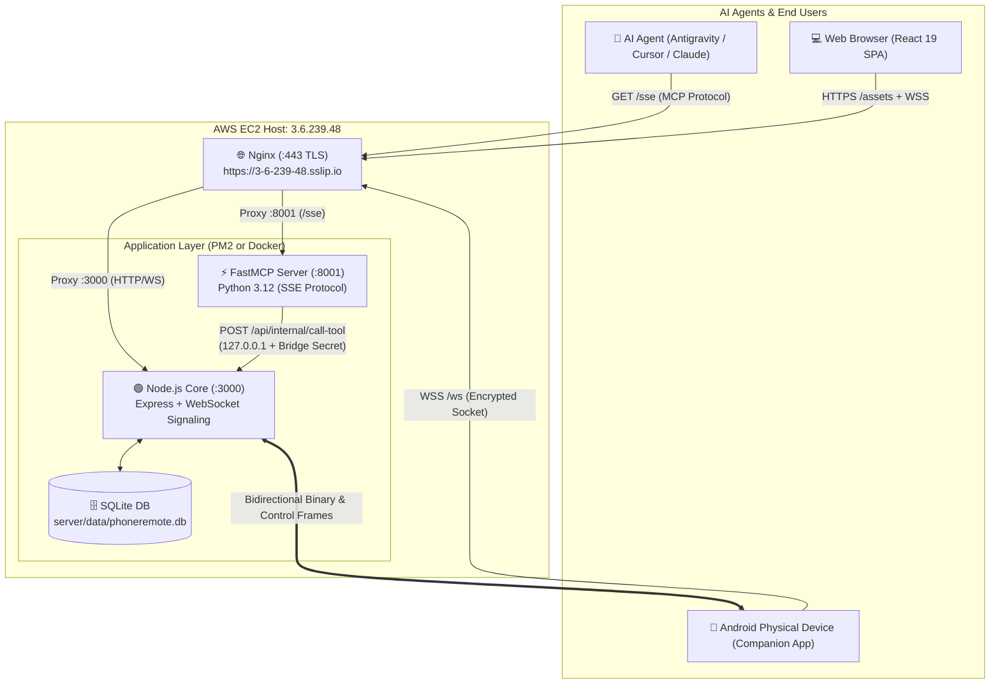

# 🧠 PROJECT MEMORY & SYSTEM MASTER ARCHITECTURE
> **Document Purpose**: Complete handover, infrastructure blueprint, access credentials, and operational manual for any incoming AI Agent or human engineer. Reading this single file allows you to immediately map out and operate the entire system.

---

## 📌 1. Executive Summary & Purpose
* **Project Name**: Phone Remote (AI Agent Control Plane for Android)
* **What it does**: Just like Claude Computer Use allows an LLM to control desktop computers, **Phone Remote** provides an autonomous AI agent control plane for physical Android devices via the **Model Context Protocol (MCP)**.
* **Core Capabilities**:
  - Live low-latency screen mirroring & touch dispatch (taps, swipes, typing, hardware keys).
  - High-precision structured accessibility perception (`get_ui_tree`) providing normalized `(x, y)` coordinates directly from Android's `AccessibilityNodeInfo`.
  - Reactive screen polling (`wait_for`) without expensive vision OCR loops.
  - Bidirectional file transfers (PC $\leftrightarrow$ Phone `/storage/emulated/0`).
  - Real-time GPS tracking and geofencing.
  - Camera & notification inspection (reading OTPs, SMS, alerts).

---

## ☁️ 2. AWS Cloud Infrastructure & Credentials

| Parameter | Value / Location | Notes |
| :--- | :--- | :--- |
| **Cloud Provider** | Amazon Web Services (AWS) | EC2 Virtual Machine |
| **AWS Region** | `ap-south-1` (Mumbai) | Low latency across India/Asia |
| **EC2 Instance ID** | `i-0ec6440e1d7bd748c` | `t3.medium`, Ubuntu 24.04 LTS (x86_64) |
| **Elastic IP** | `3.6.239.48` | Static public IPv4 allocated |
| **Public Hostname / Domain** | **`https://3-6-239-48.sslip.io`** | Free wildcard DNS resolving directly to Elastic IP |
| **SSH User** | `ubuntu` | Standard Ubuntu AMI login |
| **SSH Private Key (Local)** | `C:\Users\hp\.ssh\phone-remote.pem` | Perms 400 (do not lose or commit) |
| **SSH Direct Command** | `ssh -i C:\Users\hp\.ssh\phone-remote.pem ubuntu@3.6.239.48` | Or via Git Bash `& "C:\Program Files\Git\usr\bin\ssh.exe" ...` |
| **AWS Security Group** | `sg-0291d93d24ad4f7c6` | Inbound: `22` (SSH), `80` (HTTP), `443` (HTTPS) |
| **Internal Firewall Isolation** | Ports `3000` (Node) & `8001` (FastMCP) | **Closed** to the public internet; reverse-proxied via Nginx |
| **TLS / SSL Certificates** | Let's Encrypt (`certbot`) | Auto-renewing for `3-6-239-48.sslip.io` |
| **Disk & Storage Layout** | 22 GB EBS Root Volume | ~16 GB free; 2 GB `/swapfile` (reduced from 8 GB) |

---

## 🏛️ 3. Source Repositories & Workspaces

* **GitHub Repository**: [https://github.com/GuptaOum/phone-remote](https://github.com/GuptaOum/phone-remote)
* **Default Branch**: `main`
* **Local Machine Workspace**: `E:\phnrtm\phone-remote` (Windows 11)
* **Remote EC2 Workspace**: `/home/ubuntu/phone-remote` (Ubuntu 24.04)

### Monorepo Structure:
```
phone-remote/
├── client/                     # React 19 + Vite Frontend SPA
│   ├── src/
│   │   ├── pages/
│   │   │   ├── DashboardPage.jsx   # Device status, stats, quick launcher
│   │   │   ├── MirrorPage.jsx      # Low-latency screen mirror & D-Pad gestures
│   │   │   ├── FilesPage.jsx       # Segregated Phone Explorer & PC Transfer Hub
│   │   │   ├── LocationPage.jsx    # Real-time GPS Leaflet Map
│   │   │   ├── LoginPage.jsx       # Auth + Direct APK download links
│   │   │   └── McpTestPage.jsx     # Interactive MCP tool testing suite
│   │   ├── context/
│   │   │   ├── AuthContext.jsx     # JWT management & user state
│   │   │   └── DeviceContext.jsx   # WebSocket relay connection & message dispatch
│   │   └── App.jsx
│   └── package.json
├── server/                     # Node.js Core Backend + Python FastMCP
│   ├── src/
│   │   ├── services/
│   │   │   ├── signaling.js    # Multi-tenant WebSocket relay & frame router
│   │   │   └── db.js           # SQLite local ORM & user/device registry
│   │   ├── routes/
│   │   │   ├── auth.js         # JWT login, registration, token verification
│   │   │   ├── files.js        # File upload/download streaming endpoints
│   │   │   └── mcp.js          # Node.js internal bridge router (/api/internal/call-tool)
│   │   └── index.js            # Express server entry point (port 3000)
│   ├── fastmcp_server.py       # ⚡ FastMCP Python Server (port 8001, SSE transport)
│   ├── requirements-mcp.txt    # fastmcp, httpx, uvicorn
│   └── data/
│       └── phoneremote.db      # SQLite database file
├── flutter_app/                # Android Companion App (Flutter 3.44.6)
│   ├── android/                # Native Accessibility Service & Foreground Service
│   └── lib/                    # Screen capture, WebSocket client, GPS reporter
├── nginx/                      # Nginx configurations & Dockerfile
│   └── default.conf            # SSL termination, WebSockets, /sse streaming
├── docker-compose.yml          # Containerized multi-service deployment
├── Dockerfile                  # Production build for Node + React
├── Dockerfile.mcp              # Production build for FastMCP Python
├── DEPLOY.md                   # Legacy AWS deployment documentation
└── PROJECT_MEMORY.md           # 🧠 THIS FILE (Source of Truth)
```

---

## ⚙️ 4. Runtime Architecture & Network Topology



### Internal Bridge Authentication:
* **Secret**: `phone-remote-internal-bridge-secret-key-2026`
* FastMCP communicates with the Node.js signaling core over loopback `127.0.0.1:3000` via header `x-internal-secret`. External requests cannot forge this.

---

## 🐳 5. Docker Hub & Containerization

Docker Hub User: **`oumgupta`**

| Container | Image Tag | Purpose |
| :--- | :--- | :--- |
| **`phone-remote-app`** | `oumgupta/phone-remote-app:latest` | React production bundle + Express Node.js signaling core |
| **`phone-remote-mcp`** | `oumgupta/phone-remote-mcp:latest` | Python 3.12 FastMCP server |
| **`phone-remote-nginx`** | `oumgupta/phone-remote-nginx:latest` | Alpine Nginx with Let's Encrypt SSL & WebSocket proxy |

### Orchestration:
```bash
# Run multi-container stack via Docker Compose
docker compose up -d

# Check running containers
docker compose ps
```

---

## ⚡ 6. FastMCP Tool Catalog (All 26 Tools)

The FastMCP server (`server/fastmcp_server.py`) exposes 26 standardized tools:

### Device Perception & Inspection
1. **`list_devices()`**: Returns all linked phones, online/offline status, model, and live screen resolution.
2. **`get_location(deviceId)`**: Returns cached GPS fix (lat, lng, accuracy, altitude, timestamp).
3. **`get_device_status(deviceId)`**: Checks battery level, screen state, network type, and Accessibility status.
4. **`get_foreground_app(deviceId)`**: Returns active package name (e.g. `com.whatsapp`).
5. **`get_ui_tree(deviceId, all=False, filter="")`**: **The Core Perception Engine**. Returns structured text tree of all visible buttons, input fields, labels, with **exact normalized `(x, y)` center coordinates (0.0 – 1.0)**.
6. **`wait_for(deviceId, text, id, app, gone, timeout)`**: Polls accessibility tree every 600ms until condition is met.
7. **`list_apps(deviceId, filter="")`**: Returns installed apps with display names and package identifiers.

### Touch & Hardware Interaction
8. **`take_screenshot(deviceId)`**: Returns raw screen image as JPEG.
9. **`tap(deviceId, x, y)`**: Taps normalized coordinate `(0.0 - 1.0)`.
10. **`long_press(deviceId, x, y, ms=700)`**: Press and hold gesture.
11. **`swipe(deviceId, x1, y1, x2, y2, ms=300)`**: Precision drag/swipe gesture.
12. **`scroll(deviceId, direction, amount=0.6)`**: Directional scroll (`up`, `down`, `left`, `right`).
13. **`type_text(deviceId, text, method="set", submit=False)`**: Injects text into focused field; optional Enter submit.
14. **`press_key(deviceId, key)`**: Physical buttons (`back`, `home`, `recents`, `lock`, `volume_up`, `volume_down`).

### OS & Application Control
15. **`open_app(deviceId, name, package)`**: Launches app by title or package name.
16. **`open_app_drawer(deviceId)`**: Opens home screen application drawer.
17. **`open_url(deviceId, url)`**: Opens web URL or scheme (`whatsapp://`, `tel:`, etc.).
18. **`wait(deviceId, seconds=1.5)`**: Pauses execution for screen animations.

### Hardware & Alerts
19. **`ring(deviceId)`**: Rings phone at full volume (bypasses silent mode).
20. **`flash_light(deviceId, count=3)`**: Strobe camera flash.
21. **`read_notifications(deviceId, filter="", limit=20)`**: Reads incoming OTPs, SMS, and status bar alerts.

### File System & Transfers
22. **`list_files(deviceId, path="/")`**: Browses phone storage `/storage/emulated/0`.
23. **`get_file(deviceId, path)`**: Generates secure download URL to fetch file from phone.
24. **`send_local_file(deviceId, name, folder="Download")`**: Generates upload URL to send file to phone.
25. **`send_file(deviceId, name, data_base64, folder="Download")`**: Sends base64 payload directly.
26. **`send_url(deviceId, url, name, folder="Download")`**: Directs phone to download remote URL.

---

## 📱 7. Android Companion App
* **APK Download URL**: [`https://3-6-239-48.sslip.io/phone-remote.apk`](https://3-6-239-48.sslip.io/phone-remote.apk)
* **Storage Location on EC2**: `/home/ubuntu/phone-remote/client/dist/phone-remote.apk` and `server/public/phone-remote.apk`
* **Default Server URL configured**: `https://3-6-239-48.sslip.io`
* **Required Device Permissions**:
  1. **Accessibility Service**: Must be enabled in Android Settings $\rightarrow$ Accessibility $\rightarrow$ Phone Remote (allows taps, swipes, hardware keys, and UI tree extraction).
  2. **Screen Recording (MediaProjection)**: Granted once when stream starts.
  3. **Storage / All Files Access**: Required for `/storage/emulated/0` file explorer.
  4. **Location**: Required for GPS tab.
* **Current release**: v1.3.0 (versionCode 3) — [GitHub release](https://github.com/GuptaOum/phone-remote/releases/tag/v1.3.0).
* **Streaming ownership (v1.3.0)**: `ConnectionForegroundService` owns screen + camera capture; Flutter only mirrors state via `_screen_started` / `_screen_stopped`. `ScreenCaptureService` creates ONE virtual display per consent (Android 14 tokens are single-use) and drops the token on stop for API 34+, so the next start re-prompts. After every `auth_ok` the phone re-announces `stream_started` / `camera_streaming` if capture survived a socket blip.

### Building the APK on EC2
```bash
# Upload sources (never overwrite android/local.properties on EC2):
tar -czf flutter_src.tgz -C flutter_app --exclude=android/local.properties --exclude=android/.gradle --exclude=android/app/build --exclude=build --exclude=.dart_tool lib android pubspec.yaml
# Build detached, ONE at a time (two concurrent builds share the build dir and crawl):
ssh ... 'cd ~/phone-remote/flutter_app && nohup ~/flutter/bin/flutter build apk --release > /tmp/apk_build.log 2>&1 < /dev/null &'
# ~10 min cold on t3.medium. Then copy build/app/outputs/flutter-apk/app-release.apk to
# server/public/phone-remote.apk AND client/dist/phone-remote.apk.
```

---

## 🛠️ 8. Routine Operations & Deployment Runbook

### A. Deploy Frontend Updates (Vite React SPA)
```bash
# 1. On local machine (E:\phnrtm\phone-remote\client):
cd E:\phnrtm\phone-remote\client
npm run build

# 2. Sync built dist to EC2:
& "C:\Program Files\Git\usr\bin\scp.exe" -i C:\Users\hp\.ssh\phone-remote.pem -r dist/* ubuntu@3.6.239.48:/home/ubuntu/phone-remote/client/dist/
```

### B. Deploy Server Updates (Node.js & Python)
```bash
# 1. Copy changed server files to EC2:
& "C:\Program Files\Git\usr\bin\scp.exe" -i C:\Users\hp\.ssh\phone-remote.pem -r server/src server/fastmcp_server.py ubuntu@3.6.239.48:/home/ubuntu/phone-remote/server/

# 2. Restart PM2 on EC2:
& "C:\Program Files\Git\usr\bin\ssh.exe" -i C:\Users\hp\.ssh\phone-remote.pem ubuntu@3.6.239.48 "pm2 restart all && pm2 status"
```

### C. Check Logs & Health
```bash
# Check PM2 processes:
ssh -i C:\Users\hp\.ssh\phone-remote.pem ubuntu@3.6.239.48 "pm2 status"

# View real-time logs:
ssh -i C:\Users\hp\.ssh\phone-remote.pem ubuntu@3.6.239.48 "pm2 logs --lines 50 --nostream"

# Test health endpoint:
curl -k https://3-6-239-48.sslip.io/health
# Response: {"ok":true}
```

---

## 🚨 9. Known Quirks & Troubleshooting Guide

1. **Stale `cursor-remote.lock` on Windows Host**:
   - *Symptom*: Remote SSH into the local Windows machine fails with *"cursor-remote.lock is used by another process"*.
   - *Fix*: Delete `C:\Users\hp\.cursor-server\bin\win32-x64\*\cursor-remote.lock`.
2. **EC2 Disk Space Exhaustion**:
   - *Symptom*: `apt install` or Docker build fails with *No space left on device*.
   - *Root Cause*: Previous 8 GB `/swapfile` consumed 36% of disk.
   - *Fix*: Kept at 2 GB (`sudo truncate -s 2G /swapfile && sudo mkswap /swapfile && sudo swapon /swapfile`). Prune unused Docker images with `docker system prune -f`.
3. **Screen Mirror Frame Lag / Catch-22**:
   - *Rule*: Never block frame decoding on `if (!streaming) return` before setting `streaming: true`.
   - *Architecture*: Frames decode off-thread via `createImageBitmap(blob)` directly to canvas. Stale frames are dropped via `latestBlobRef` to guarantee real-time latency.
4. **PM2 Process Mapping on EC2**:
   - `id 0`: `phone-remote` (Node.js server, port 3000)
   - `id 1`: `phone-remote-fastmcp` (Python FastMCP server, port 8001)
5. **Phone dropping offline every few minutes**:
   - *Root Cause*: OkHttp `pingInterval(3s)` killed the socket whenever one pong was late on mobile data. Now 10s; the server's 15s heartbeat still reaps dead sockets.
6. **Killing processes on EC2 over SSH**:
   - `pkill -f <name>` / `pgrep -f <name>` match the SSH command line itself. Use the bracket trick (`grep '[G]radleDaemon'`) or `./gradlew --stop`.

---
*Created & Maintained by Google Antigravity & User Team. Last Updated: October 30, 2026.*
