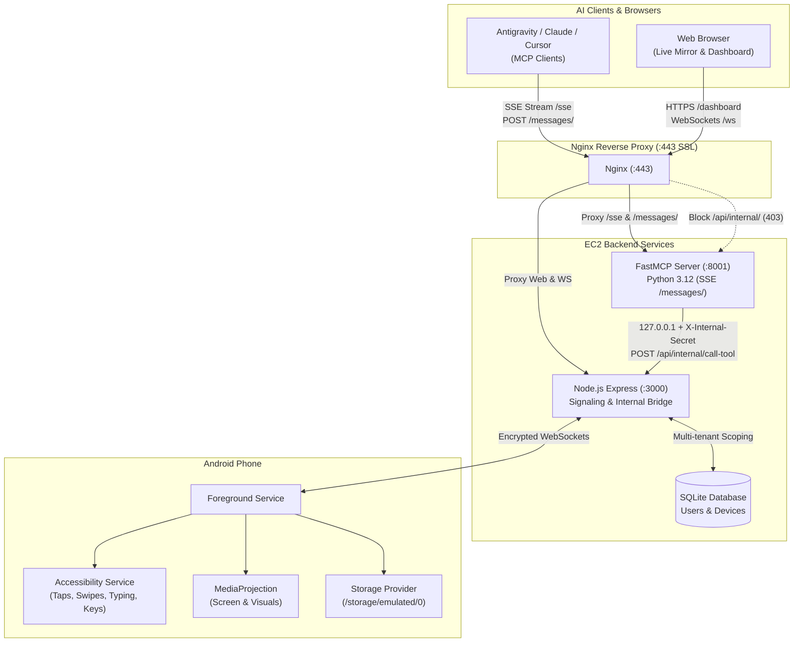

# Phone Remote: AI Agent Dispatch for Android

Just like Claude Computer Use / Dispatch allows an LLM to control a laptop, **Phone Remote** is an AI agent control plane for your Android phone. It enables large language models and autonomous AI agents (such as Google Antigravity, Claude, and Cursor) to remote-control an Android device using the **Model Context Protocol (MCP)**.

---

## ⚡ Highlights
- **FastMCP Python Architecture:** Powered by an ultra-lean 162-line [FastMCP](https://github.com/jlowin/fastmcp) Python server (`fastmcp_server.py`), replacing 1,270+ lines of manual JSON-RPC boilerplate (**87.3% code reduction**).
- **26 Standardized Tools:** 100% feature coverage spanning gestures, structured UI tree analysis, notifications/OTPs, system keys, apps, hardware, and raw file transfers.
- **Structured UI Perception (`get_ui_tree`):** Reads the Android accessibility node tree into structured text with normalized coordinates (0.0–1.0) so agents can target elements with zero pixel hallucinations and minimal latency.
- **Dual Transport & Live Dashboard:** Supports SSE streaming (`/sse`) for modern MCP agents alongside an interactive web mirror & dashboard.
- **Production Hardened:** Reverse-proxied via Nginx with TLS, loopback IP isolation, internal pre-shared secret validation, and multi-tenant scoping.

---

## 🏛️ Architecture & Data Flow



---

## 🛠️ Complete MCP Tool Suite (26 Tools)

All coordinates are normalized from `0.0` to `1.0` (fraction of screen width and height):

### 1. Device Inspection & Health
| Tool | Description |
|---|---|
| `list_devices` | List all Android phones linked to the user account with live screen resolution and online status. |
| `get_device_status` | Health check: battery %, screen on/off, accessibility service state, foreground app, network type. |
| `get_location` | Fetches the most recent cached GPS coordinates (lat, lng, accuracy, altitude). |
| `get_foreground_app` | Gets the package name of the app currently visible on screen (e.g. `com.whatsapp`). |
| `get_ui_tree` | Reads the screen as a structured node tree (text, resource ID, bounds, clickable/editable flags). |
| `wait_for` | Polls the UI tree until specific text, resource ID, or app package appears or disappears. |
| `list_apps` | Lists all installed applications on the phone with display labels and package identifiers. |

### 2. Interaction & Navigation
| Tool | Description |
|---|---|
| `take_screenshot` | Captures the screen as a JPEG image with automatic server-side resolution optimization. |
| `tap` | Taps at normalized coordinates `x`, `y` (e.g. `x=0.5, y=0.5` for center screen). |
| `long_press` | Presses and holds at `x`, `y` for a configurable duration (default 700ms) to trigger context menus. |
| `swipe` | Swipes with precision from `(x1, y1)` to `(x2, y2)` over `ms` milliseconds. |
| `scroll` | Scrolls content in direction (`up`, `down`, `left`, `right`) by fraction `amount`. |
| `type_text` | Enters text into focused field; supports direct input (`method: set`) or clipboard paste fallback (`paste`). |
| `press_key` | Presses system buttons: `back`, `home`, `recents`, `enter`, `delete`, `notifications`, `lock`, `volume_up`. |
| `open_app` | Launches an app by name (e.g. "YouTube", "Settings") or explicit package name. |
| `open_app_drawer` | Navigates home and swipes up into the Android app search drawer. |
| `open_url` | Opens a web link or deep link (`https://`, `tel:`, `mailto:`, `whatsapp://`). |
| `wait` | Non-blocking pause for a specified duration (default 1.5s) to allow animations to settle. |

### 3. Hardware & Notification Controls
| Tool | Description |
|---|---|
| `ring` | Rings the phone at full volume even in silent/DND mode (ideal for device finding). |
| `flash_light` | Blinks the physical camera LED flash a specified number of times. |
| `read_notifications` | Reads incoming and recent status bar notifications (OTPs, messages, alerts). |

### 4. File Management & Streaming Transfers
| Tool | Description |
|---|---|
| `list_files` | Lists files and directories under `/storage/emulated/0`. |
| `get_file` | Generates a secure, one-time signed download URL (valid 10 mins, up to 100 MB). |
| `send_local_file` | Generates a secure one-time upload URL to stream a file from your machine to the phone. |
| `send_file` | Transfers small files inline using base64 encoding (up to 18 MB). |
| `send_url` | Directs the server to download a public HTTP URL directly into phone storage (up to 100 MB). |

---

## 🔌 Connecting MCP Clients

### 1. Antigravity Configuration
In your `~/.gemini/config/mcp_config.json`:
```json
{
  "mcpServers": {
    "phone-remote": {
      "serverUrl": "https://3-6-239-48.sslip.io/sse",
      "headers": {
        "Authorization": "Bearer <YOUR_JWT_TOKEN>"
      }
    }
  }
}
```

### 2. Claude Desktop Configuration
In your `claude_desktop_config.json`:
```json
{
  "mcpServers": {
    "phone-remote": {
      "url": "https://3-6-239-48.sslip.io/sse",
      "headers": {
        "Authorization": "Bearer <YOUR_JWT_TOKEN>"
      }
    }
  }
}
```

---

## 🔒 Security & Defense-in-Depth

- **Perimeter Gate:** The internal bridge `/api/internal/*` is blocked with `403 Forbidden` at Nginx.
- **Loopback Enforcement:** Node.js verifies that tool dispatch calls originate strictly from loopback (`127.0.0.1` / `::1`).
- **Bridge Secret:** All inter-service communications require a pre-shared `x-internal-secret` header.
- **Multi-Tenant Scoping:** All operations are strictly authenticated and bounded to the requesting user's paired device UUIDs.

---

## 📱 Android Client Requirements

The Android companion client utilizes native APIs without requiring root:
- **`RemoteAccessibilityService`:** Injects touch events and dispatches key events.
- **`MediaProjection`:** Captures and streams screen frames back to the server.
- **`NotificationListenerService`:** Reads incoming notifications and OTPs.

---

## 📄 License
MIT License
