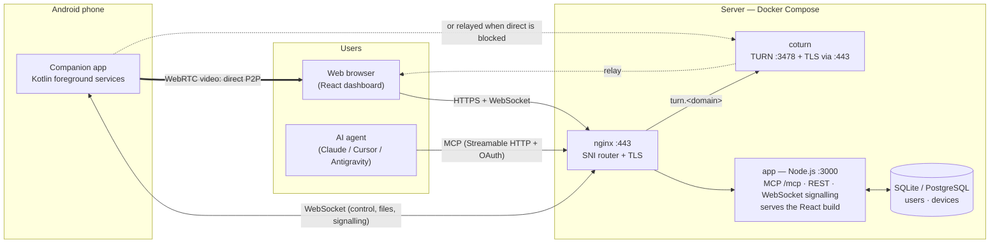

# Phone Remote

**An MCP server that gives AI agents a real Android phone, plus a live browser dashboard to watch and take over.**

Phone Remote is a self-hosted, multi-user platform that lets AI agents (Claude,
Cursor, Antigravity, …) see and operate Android phones through the Model
Context Protocol (MCP): read the screen, tap, type, open apps, read OTPs and
move files. The same phones are available to people in a web dashboard that
streams the screen and camera over WebRTC and accepts touch input back.

It runs without root: a native Android companion app does the capture and input
work, and everything keeps running in the background after the app is closed.

---

## Contents

- [Features](#features)
- [Architecture](#architecture)
- [How streaming works](#how-streaming-works)
- [Tech stack](#tech-stack)
- [Repository layout](#repository-layout)
- [Quick start (local development)](#quick-start-local-development)
- [Production deployment](#production-deployment)
- [Configuration](#configuration)
- [The Android app](#the-android-app)
- [AI agents (MCP)](#ai-agents-mcp)
- [Security](#security)
- [Diagnostics and troubleshooting](#diagnostics-and-troubleshooting)
- [Further documentation](#further-documentation)

---

## Features

**AI agent control (MCP)**

- **27 tools.** Gestures, a structured UI tree with normalized coordinates, waiting for screen states, apps (open, list, uninstall), deep links, notifications/OTPs, hardware, and file transfer.
- **One modern endpoint.** Streamable HTTP at `/mcp` with OAuth 2.1 + PKCE and dynamic client registration: paste the URL, sign in, approve. A plain `Authorization: Bearer` token works too.
- **Per-account isolation.** An agent only ever sees the phones of the account that approved it, and the approval page shows which account that is.

**Web dashboard (React)**

- **Live screen mirror with touch control.** Tap, swipe, scroll, type, use system keys. The phone frame follows the phone's orientation, so landscape videos and games fill the view.
- **Live camera.** Front or back camera, also over WebRTC.
- **File manager.** Browse the phone's storage, upload with drag and drop, and download. Your place survives a page refresh.
- **Location**, **ring** (even on silent), **flashlight blink**, **screenshots**.
- **Multi-account, multi-device.** Each user sees only their own phones, with live online status.

**Streaming**

- **WebRTC only.** Hardware H.264/VP8 encoding at up to 60 fps, typically 3–5× less data than frame-by-frame images.
- **Works across networks.** A direct peer-to-peer path when possible; otherwise a built-in TURN relay over UDP, TCP, or TLS on port 443, which gets through firewalls that only allow HTTPS.
- **Survives network switches.** Moving between Wi-Fi and mobile data repairs the same call (ICE restart), measured at 1–6 s, with automatic fallbacks so it never stays stuck.
- **Low latency.** Real-time encoding that keeps the frame rate and lowers resolution under tight bandwidth, and no playback buffering.

**Operations**

- **One command to deploy.** `docker compose up -d --build` starts the web app and MCP server, nginx and the TURN relay.
- **Free HTTPS.** Let's Encrypt certificates with automatic renewal.

---

## Architecture



- **Control plane.** The phone holds a persistent secure WebSocket to the server. Every command (touch, keys, files, MCP tool calls) and all WebRTC signalling goes through it, scoped to the authenticated account and device.
- **Media plane.** Screen and camera video go **directly from phone to browser** over WebRTC. Only when no direct path exists does the video pass through the server's TURN relay.
- **Background operation.** Capture, input injection, the socket and WebRTC all live in native Kotlin foreground services, so streaming continues with the app UI closed.

---

## How streaming works

1. You click **Start Streaming** or **Front/Back camera**. The browser sends a WebRTC offer through the server, and the phone answers.
2. The phone's capture (MediaProjection for the screen, Camera2 for the camera) is routed straight into a hardware video encoder.
3. WebRTC tries every phone↔browser address pair and uses the best one that works:

   | Order | Path | Typical latency | Used when |
   |---|---|---|---|
   | 1 | Direct, same network | ~5 ms | Phone and browser on the same Wi-Fi |
   | 2 | Direct over the internet (STUN / IPv6) | 20–60 ms | Most home and mobile networks |
   | 3 | TURN relay, UDP/TCP 3478 | +50–100 ms | Strict NAT / carrier-grade NAT |
   | 4 | TURN relay, TLS on 443 | +50–100 ms | Networks that only allow HTTPS |

4. **When the network changes** (for example Wi-Fi → mobile data), the phone reconnects instantly and the browser **ICE-restarts** the same call onto the new path. If that can't complete, it falls back to a fresh call, with a 20 s safety deadline and page watchdogs, so the stream always comes back on its own.

> The legacy JPEG-over-WebSocket streaming path still exists in the code but is
> switched off (`JPEG_FALLBACK = false`). Screenshots for AI agents are
> unaffected.

---

## Tech stack

| Layer | Technology |
|---|---|
| Android app | Flutter (UI) + **Kotlin** foreground services, libwebrtc (`io.github.webrtc-sdk:android`), MediaProjection, Camera2, AccessibilityService, NotificationListenerService, OkHttp |
| Web client | React 19, Vite, Context API, `lucide-react` |
| Server + MCP | Node.js 22, Express, `ws`, JWT (bcryptjs), `@modelcontextprotocol/sdk` (Streamable HTTP), `sharp` |
| Media relay | coturn 4.7 (TURN REST API, short-lived HMAC credentials) |
| Data | SQLite (default) or PostgreSQL (`DATABASE_URL`) |
| Infrastructure | Docker Compose, nginx (stream SNI router + TLS), Let's Encrypt, AWS EC2 |

---

## Repository layout

```
.
├── client/                 React web dashboard (Vite)
│   └── src/
│       ├── context/        Auth + device/WebSocket state (DeviceContext)
│       ├── hooks/          useRtcStream — WebRTC client, ICE restart, recovery
│       └── pages/          Dashboard, Mirror, Camera, Files, Location, MCP test
├── server/                 Node.js backend
│   ├── src/
│   │   ├── routes/         mcp (27 tools, Streamable HTTP), oauth, auth, files
│   │   └── services/       signaling (WebSocket hub), turn, db, oauthStore
│   └── public/             OAuth consent page
├── flutter_app/            Android companion app
│   ├── lib/                Flutter UI (login, home, files)
│   ├── android/app/src/main/kotlin/com/phoneremote/
│   │                       Native services: connection, screen/camera capture,
│   │                       WebRTC, accessibility input, notifications
│   └── tool/verify_release_apk.sh   Release-build regression check
├── nginx/                  nginx image: SNI router (stream.conf) + site (default.conf)
├── docker-compose.yml      nginx · app · coturn (+ turn-init)
├── DEPLOY.md               Production deployment runbook
└── MCP_PHONE_NAVIGATION.md Playbook for AI agents (deep links, app navigation)
```

---

## Quick start (local development)

**Prerequisites:** Node.js 22+, Flutter 3.44+ with Android SDK 36 / NDK 28.2, and an Android phone running Android 7.0 or later.

```bash
# 1. Server
cd server
cp .env.example .env          # set JWT_SECRET (see Configuration)
npm install
npm run dev                   # http://localhost:3000
```

```bash
# 2. Web client (proxies /api, /ws and /mcp to :3000)
cd client
npm install
npm run dev                   # http://localhost:5173
```

```bash
# 3. Android app — point it at your server and run on a USB-connected phone
cd flutter_app
flutter run
```

Create an account in the browser, sign in with the same account on the phone,
and grant the permissions the app asks for. The phone then appears on the
dashboard.

> Without a TURN server, WebRTC still works when the phone and browser can reach
> each other directly (for example on the same Wi-Fi).

---

## Production deployment

The whole stack is defined in `docker-compose.yml`:

```bash
cd ~/phone-remote
sudo docker compose up -d --build
```

| Service | Role |
|---|---|
| `nginx` | Public `:80/:443`. Routes TLS by hostname: `turn.<domain>` → TURN, everything else → the site |
| `app` | Node.js server: MCP endpoint, REST, WebSocket signalling, and the built React client |
| `coturn` | TURN relay (host networking, relay ports 49160–49200/udp) |
| `turn-init` | One-shot job that generates the TURN shared secret on first run |

**Firewall:** open 80/tcp, 443/tcp, 3478/tcp+udp and 49160–49200/udp.

**Certificates:** one Let's Encrypt certificate must cover both `<domain>` and `turn.<domain>`.

The complete runbook — certificates, redeploys, building and publishing the
APK, image publishing and moving to your own domain — is in
**[DEPLOY.md](DEPLOY.md)**.

---

## Configuration

**`server/.env`**

| Variable | Required | Description |
|---|---|---|
| `JWT_SECRET` | yes | Secret used to sign login tokens. Generate a long random value. |
| `PUBLIC_URL` | yes (prod) | Public base URL, for example `https://example.com`. Used for OAuth metadata and TURN hostnames. |
| `PORT` | no | HTTP port, default `3000`. |
| `TOKEN_TTL` | no | Login token lifetime, default `30d`. |
| `DATABASE_URL` | no | PostgreSQL connection string. Empty means SQLite in `server/data/`. |
| `FILE_DIR` | no | Root folder for per-account file storage. |

**Set by `docker-compose.yml` (override from the shell or a root `.env`)**

| Variable | Description |
|---|---|
| `DOMAIN` | Public hostname. nginx and the TURN-over-TLS hostname follow it. |
| `TURN_EXTERNAL_IP` / `TURN_PRIVATE_IP` | Override coturn's auto-detected public and private addresses. |
| `TURN_TLS_HOST` | Hostname for `turns:` on 443, default `turn.${DOMAIN}`. |
| `TURN_SECRET_FILE` | Shared TURN secret, generated automatically by `turn-init`. |
| `DOWNLOADS_DIR` | Mounted folder served at the site root (for example `/phone-remote.apk`). |

**Feature switches**

| Switch | Where | Default |
|---|---|---|
| `ICE_RESTART` | `client/src/hooks/useRtcStream.js` | `true`: repair calls across network switches |
| `ICE_RESTART_HINT` | `server/src/services/signaling.js` | `true`: tell browsers to repair when the phone reconnects |
| `JPEG_FALLBACK` | `useRtcStream.js` + `ConnectionForegroundService.kt` | `false`: WebRTC-only streaming |

---

## The Android app

**Install.** Download `/phone-remote.apk` from your server, install it, sign in, and grant:

| Permission | Used for |
|---|---|
| Screen capture (asked on first stream) | Screen mirroring |
| Accessibility service | Touch, swipe, typing, system keys, UI tree |
| Notification access | `read_notifications` (OTPs, messages) |
| Camera, location, storage | Camera stream, location, file manager |
| Battery: unrestricted | Keeps the background service alive on aggressive OEMs |

**Build a release APK.** Run the regression check every time:

```bash
cd flutter_app
flutter build apk --release
bash tool/verify_release_apk.sh   # must print PASS
```

libwebrtc ships no shrinker rules. If R8 strips its Java classes, the app
crashes the moment WebRTC starts. `android/app/proguard-rules.pro` keeps them,
and `verify_release_apk.sh` fails the build if they go missing again.

---

## AI agents (MCP)

One endpoint, `https://<domain>/mcp`, using the current MCP transport
(Streamable HTTP). All coordinates are normalized from `0.0` to `1.0` (a
fraction of the screen width and height), not pixels.

**Connecting.** The server advertises OAuth 2.1 discovery
(`/.well-known/oauth-protected-resource`) and dynamic client registration, so
most clients only need the URL. On first use a browser window opens: sign in
to Phone Remote (if you aren't already), check the **Signed in as** account,
and click **Approve**.

| Client | How to add it |
|---|---|
| claude.ai, Claude Desktop, Claude mobile | *Settings → Connectors → Add custom connector* → `https://<domain>/mcp` |
| Claude Code | `claude mcp add --transport http phone-remote https://<domain>/mcp`, then `/mcp` → *Authenticate* |
| Cursor, Antigravity and other HTTP clients | Add a remote server with URL `https://<domain>/mcp` |

Clients that can't run the OAuth flow can send a login token instead
(`POST /api/login` returns one):

```json
{
  "mcpServers": {
    "phone-remote": {
      "url": "https://<domain>/mcp",
      "headers": { "Authorization": "Bearer <YOUR_TOKEN>" }
    }
  }
}
```

> The legacy SSE transport (`/sse`) was removed: Streamable HTTP replaced it in
> the MCP specification, and every client listed above supports it.

**Tools**

| Group | Tools |
|---|---|
| Device and perception | `list_devices`, `get_device_status`, `get_location`, `get_foreground_app`, `get_ui_tree`, `wait_for`, `list_apps`, `take_screenshot` |
| Interaction | `tap`, `long_press`, `swipe`, `scroll`, `type_text`, `press_key`, `wait` |
| Apps and navigation | `open_app`, `open_app_drawer`, `open_url` |
| Hardware and notifications | `ring`, `flash_light`, `read_notifications` |
| Files | `list_files`, `get_file`, `send_local_file`, `send_file`, `send_url` |

`get_ui_tree` returns every visible text, button and input with ready-to-tap
coordinates. Agents should prefer it over screenshots: it's faster, cheaper, and
leaves no room for guessing pixels. For app-specific deep links and navigation
recipes, see [MCP_PHONE_NAVIGATION.md](MCP_PHONE_NAVIGATION.md).

---

## Security

- **Accounts:** bcrypt-hashed passwords and JWT sessions. Every WebSocket, REST and MCP operation is scoped to the authenticated account and its own devices.
- **Device revocation:** removing a device on the dashboard disconnects it and rejects its old tokens.
- **MCP / OAuth:** PKCE (S256) is required, redirect URIs must match the registered client, and the approval page shows the signed-in account with a *Switch account* link, so a browser logged in to the wrong account can't silently link it.
- **TURN:** credentials are short-lived (24 h, HMAC-signed per user), the relay refuses private and loopback destinations, and wrong credentials get `401`.
- **Transport:** HTTPS/WSS everywhere, and WebRTC media is encrypted end to end (DTLS-SRTP).
- **Files:** one-time signed URLs for downloads and uploads, with per-account storage roots.

---

## Diagnostics and troubleshooting

**WebRTC on the phone** (USB debugging enabled):

```bash
adb logcat -s PhoneRemote
# rtc screen: 60fps 564x1266 1400kbps limit=bandwidth path=host/udp→srflx rtt=0.032
```

`path` shows the route: `host`, `srflx` and `prflx` are direct; `relay` goes through coturn. `limit` shows what is capping quality.

**WebRTC in the browser:** each step is reported to the server log:

```bash
cd ~/phone-remote && docker compose logs app-blue app-green | grep -E "🔗|🧭"
# 🧭 rtc screen ice-restart attempt 1
# 🧭 rtc screen answer
# 🔗 WebRTC screen connected
```

| Symptom | Check |
|---|---|
| App closes the moment streaming starts | Run `tool/verify_release_apk.sh`: R8 keep rules missing |
| Stuck on "Connecting video…" | `🧭` trace; TURN ports open; `turn.<domain>` included in the certificate |
| Phone shows offline | App battery set to Unrestricted; the phone's own logs |
| Agent gets `401` | Token expired: sign in again, or re-authorize the connector |

---

## Further documentation

- **[DEPLOY.md](DEPLOY.md):** production runbook (EC2, Docker Compose, TLS, TURN, APK publishing).
- **[MCP_PHONE_NAVIGATION.md](MCP_PHONE_NAVIGATION.md):** playbook for AI agents operating the phone.
- **[PROJECT_MEMORY.md](PROJECT_MEMORY.md):** design history and project notes.
